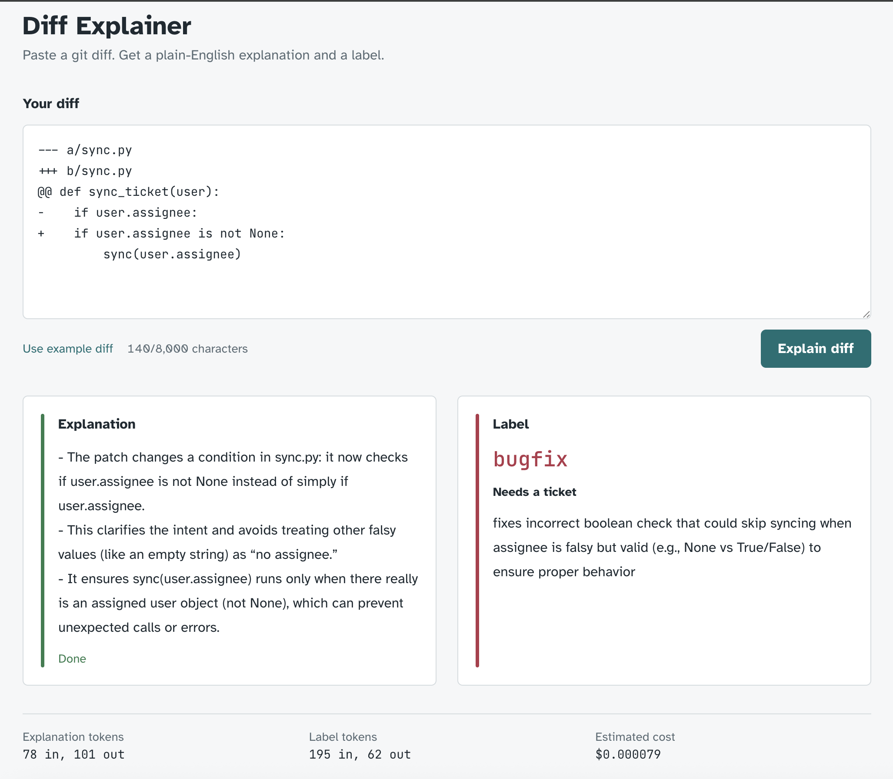
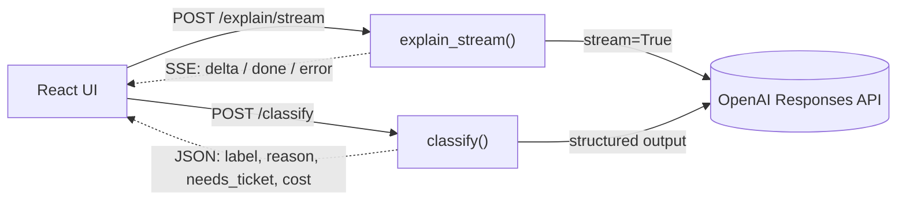

# Diff Explainer

Paste a git diff. Get a plain-English explanation that **streams in as it is written**, plus a **structured classification** (label, reason, and whether it needs a ticket). The footer shows the token usage and cost of each run.



## Features

- **Streaming explanation**: the first words appear within about 2 seconds.
- **Structured classification**: `feature` / `bugfix` / `docs` / `refactor`, a one-sentence reason, and `needs_ticket`.
- **Stop at any time**: Stop cancels both requests and closes the upstream LLM connection.
- **Clear errors, never stuck**: backend down, LLM error, or a cut stream each show an error. Partial text is kept and marked as incomplete.
- **Cost per run**: input / output tokens and estimated USD cost.
- **Accessible streaming**: screen readers hear state changes ("Explaining the diff…", "Explanation ready."), not every streamed token.

## Architecture

The same diff goes to two independent endpoints at the same time. Neither waits for the other.



The backend is split into layers. Dependencies only point down: `routes → services → llm`.

| File | Responsibility |
|---|---|
| `app/main.py` | Create the app, set up CORS, mount the routers |
| `app/routes.py` | HTTP only: read the request, call a service, return a response or status code |
| `app/services.py` | Business logic: prompts, streaming, retry, `needs_ticket` rule. Knows nothing about HTTP |
| `app/llm.py` | OpenAI client, model settings, price table, cost. Knows nothing about diffs |
| `app/schemas.py` | Pydantic models: request, response, and what the LLM must return |

## Key trade-offs

| Decision | Why | Alternative I rejected |
|---|---|---|
| **Two independent LLM calls, sent in parallel** | Faster; one failing does not break the other; each prompt stays simple | One call for both: the result must be full JSON, so the explanation could not stream. Cost: the diff is sent twice |
| **The explanation streams, the classification does not** | A person reads the explanation word by word; code needs the full JSON to use the classification | Stream both: half a JSON object cannot be parsed |
| **`needs_ticket` and cost are computed in backend code, not by the LLM** | Deterministic, free, and prices live in one place | Ask the LLM: costs tokens and can contradict the label. Prices in the frontend: stale on every client |

Other decisions: SSE instead of WebSocket (data only flows one way, and SSE is plain HTTP); `fetch` + `ReadableStream` instead of `EventSource` (the diff must be sent with POST); each request's UI state is one TypeScript union type, so impossible states cannot be written.

## Error handling

| What went wrong | `/explain/stream` | `/classify` |
|---|---|---|
| Diff empty or over 8,000 chars | 422 (stream not started) | 422 |
| LLM call fails or is incomplete | 200 + `error` message in the stream (200 is already sent) | 502 |
| LLM output invalid after one retry | not applicable (plain text) | 502 |
| A bug in our code | 500, or the stream is cut | 500 |

## Run locally

**Backend** (Python 3.12, [uv](https://docs.astral.sh/uv/)):

```bash
cd backend
cp .env.example .env          # then add your OPENAI_API_KEY
uv sync
uv run fastapi dev app/main.py
```

API docs: http://127.0.0.1:8000/docs

**Frontend** (Node 20+):

```bash
cd frontend
npm install
npm run dev
```

Open http://localhost:5173

## Tech stack

FastAPI · Pydantic · OpenAI Responses API (`gpt-5-nano`) · React · TypeScript · Vite · Tailwind CSS

## Scope

Out of scope on purpose: login, saving history, choosing a model, and diffs over 8,000 characters.